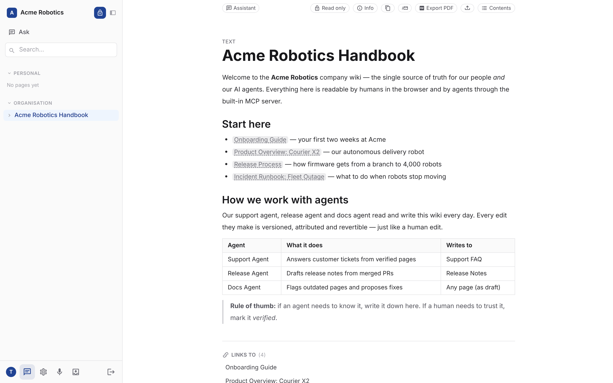
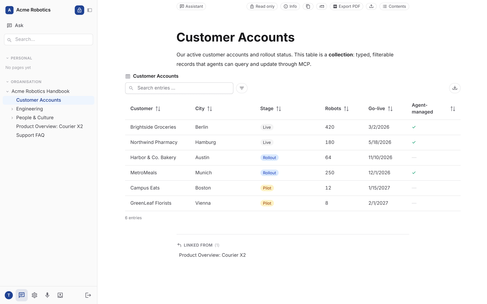
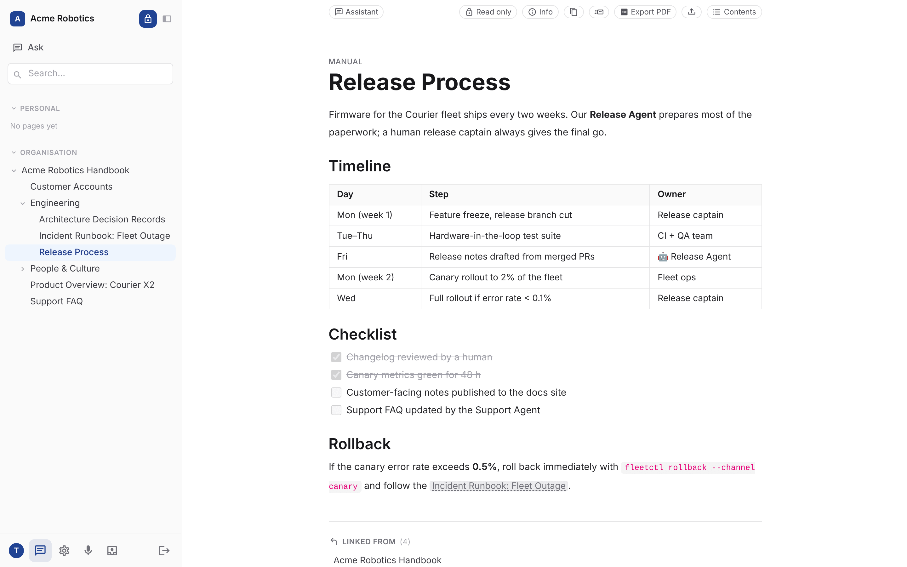

# symbiosika-wiki

[](./LICENSE)

### Work with agents & humans in one team.

**symbiosika-wiki** is an open-source company wiki built for teams where people
and AI agents share the same knowledge. Humans write in a fast, Notion-style
editor. Agents connect through a built-in MCP server and read, search and edit
the very same pages, with the same permissions, the same version history and
links back to the source. One wiki, one source of truth, for everyone on the team.



## Why symbiosika-wiki

- **Built-in MCP server for your agents.** Claude and other MCP clients connect
  at `/mcp` (OAuth2 or API token) and can discover, search, read, append and
  edit pages, query collections and run AI test suites. Every tool is annotated
  as read-only or writing, and every page in a response carries its URL, so
  agents cite their sources as clickable links.
- **Agents act as the user, not as root.** Every tool call runs with the
  signed-in user's own permissions: Personal, Team or Organisation visibility
  applies to agents exactly as it does to people.
- **Every edit is versioned.** Human or agent, each change lands in the page
  history and can be reverted.
- **Ask your wiki.** A built-in chat agent answers questions from your pages and
  links the pages it used. The **Document Assistant** applies changes you
  describe in plain language (by voice or text) directly to a page.
- **A real editor.** TipTap block editor with slash commands, Markdown input
  rules, tables, to-do lists, images, `[[wikilinks]]` and automatic backlinks.
- **Collections.** Turn any page into a typed table (text, number, date,
  select, checkbox, URL, ...) that people filter in the UI and agents query
  and update through MCP.
- **Trust signals.** Page types (manual, policy, FAQ, ...) and statuses
  (draft, verified, outdated) tell humans and agents what to rely on.
- **AI test suites.** Define questions with expected answers and measure
  whether your agents actually answer correctly from the wiki, run after run.
- **Voice daily logs.** Dictate with live transcription; an agent turns it into
  a structured, dated page with summary, key points and tasks.
- **Publish what you want.** A read-only public docs site serves only the pages
  you release, with no login.
- **Yours to run.** Apache-2.0, self-hosted, one Docker image, Postgres.

| Typed collections, shared by people and agents | Rich pages with tables, checklists and links |
| --- | --- |
|  |  |

<sub>Screenshots show fictional demo content ("Acme Robotics").</sub>

AI features (chat, Document Assistant, transcription, summaries) need an
`OPENROUTER_API_KEY` / `MISTRAL_API_KEY`; the core wiki and the MCP server work
without them.

## Features in detail

- **Pages** are framework `knowledgeTexts` with a `parentId` hierarchy and
  block content (`knowledge/texts` API: blocks, full-text/hybrid search,
  wikilinks, backlinks, version history, file-style read/edit endpoints
  for AI agents).
- **Visibility** per page: Personal (`userId`), Team (`teamId`) or
  Organisation (`tenantWide`).
- **Frontend**: Vue 3 SPA with a Notion-style TipTap block editor
  (slash commands, bubble menu, drag handle, Markdown input rules,
  to-do lists) and a collapsible page tree
  (Personal / Teams / Organisation), plus organisation/team/
  invitation management.
- **Public docs site** (`frontend-public/`): a lean, read-only
  secondary view for published pages — no login, no editor. It reads
  exclusively from the public API (`/api/v1/public/wiki/:tenantId/…`) and
  shows only what has been released via `publicMode`. Served under
  `/docs/` from `backend/public/` (the main frontend, by contrast, sits behind the
  login under `/static/app/`). See
  [`frontend-public/README.md`](./frontend-public/README.md).
- **MCP server** (`backend/src/mcp/`): an MCP server embedded in the backend
  process (reachable at `/mcp`, OAuth2/API-token auth via the
  framework) through which a chat app can use the wiki as its "Brain"
  (identity, discovery, reading, writing).
  - Every tool carries MCP **annotations** (`readOnlyHint`, `destructiveHint`,
    `idempotentHint`, `openWorldHint`) so that clients (Claude & co.) can tell reads
    from writes before making the call: all reading tools
    are `readOnlyHint: true`; the writing ones additionally mark whether they
    overwrite existing content (`destructiveHint`) and whether repeating the call
    yields the same state (`idempotentHint`). `openWorldHint` is `false`
    everywhere — the wiki is a closed domain. The hints are set
    centrally via `READ_ONLY` / `writeAnnotations()` in
    [`backend/src/mcp/tools/_define.ts`](./backend/src/mcp/tools/_define.ts);
    `annotations.test.ts` fails if a new tool forgets them.
  - Every page in a tool response carries its **`url`** alongside its `id`,
    so a chat app can link to the source instead of only knowing an opaque
    page ID. This happens generically for all tools in
    [`backend/src/mcp/page-url.ts`](./backend/src/mcp/page-url.ts) — rows that
    are not pages (teams, organisations, facet vocabularies, collection
    records) are left untouched.
  - A page's address comes from
    [`backend/src/lib/wiki/page-url.ts`](./backend/src/lib/wiki/page-url.ts) —
    a single source for all producers. It cannot be derived from the route
    table: the app lives under `/static/app/` and uses hash routing, so a
    page link is
    `${BASE_URL}/static/app/#/tenant/<tenantId>/wiki/<pageId>` (sections with
    `#anchor`). The in-app chat (`backend/src/ai/tools/wiki/`) returns
    the same path as a relative link, so a click in the answer navigates
    without a reload.
- **Dictate a daily log**: record a log by voice from the start page
  → **live transcription** (the text appears while you are still
  speaking) → AI processing (summary, key points, tasks) →
  dated page under "Tagesprotokolle" ("Daily logs"). Optional "digital-twin brain": an
  agent extracts facts into a curated topic hierarchy under
  "Wissensbasis" ("Knowledge base"). Keys: `OPENROUTER_API_KEY` (LLM/agents via OpenRouter with
  a Mistral model) and `MISTRAL_API_KEY` (live transcription).
  - Live transcription streams 16 kHz PCM (`pcm_s16le`) from the browser via
    a backend WebSocket relay (`GET …/protocol/realtime`) to Mistral's
    realtime endpoint (Voxtral). The `MISTRAL_API_KEY` stays server-side.
    The model is configurable via `MISTRAL_REALTIME_MODEL`
    (default `voxtral-mini-transcribe-realtime-2602`). Browsers without
    Web Audio/AudioWorklet support automatically fall back to
    asynchronous recording (`POST …/protocol/transcribe`).
- **Document assistant**: on every page, an "Assistent" ("Assistant") button that opens a panel
  in which you interact with the document by voice or text. You
  describe a change in natural language, and an agent works it into the
  document (adjusting existing content via string replace or appending
  new blocks) – preserving structure and applied directly. Every change is
  saved as a version (revertible via the history). LLM via OpenRouter,
  voice input via live transcription. Endpoint: `POST
  …/document-assistant` (`{ entryId, instruction }`).

## Setup

```bash
git clone https://github.com/symbiosika/wiki.git --recurse-submodules
cd wiki

# Backend
cd backend
bun install
bun run init          # creates .env with secrets

# Local dev database (PGlite, no Docker needed)
bun run db:local      # Terminal 1: starts PGlite on localhost:5432
bun run migrate       # framework + app migrations
bun run dev           # Terminal 2: API at http://localhost:3000

# Frontend
cd ../frontend
bun install
bun run dev           # http://localhost:5173/static/app/

# Public docs site (optional)
cd ../frontend-public
bun install
bun run dev           # http://localhost:5174/docs/
```

Note for the local PGlite DB: set
`POSTGRES_CONNECTION_POOL_SIZE=1` in `backend/.env`. PGlite cannot handle
interleaved parallel queries; against a real Postgres
(`bun run docker:up`) the setting is unnecessary.

Local login without SMTP: `SMTP_HOST=console.localhost` (default) writes
magic-link mails to `backend/logs/email/`. Create a test user:
`bash backend/framework/.scripts/testuser.sh http://localhost:3000`.

### Sign-in with Microsoft 365 (optional)

If the client ID **and** secret of an Entra ID app are set, the
sign-in page additionally shows the button
"Mit Microsoft 365 anmelden" ("Sign in with Microsoft 365") right on the first step. Magic-link login remains
available unchanged – Microsoft sign-in is only added on top. If either of the two
variables is missing, the button does not appear.

```env
MICROSOFT_CLIENT_ID=<Application (client) ID>
MICROSOFT_CLIENT_SECRET=<Client Secret>
# Directory: tenant GUID (own organisation only), `organizations`
# or `common` (default, any Microsoft account)
MICROSOFT_TENANT_ID=<Directory (tenant) ID>
```

In the Entra app, register exactly this as the redirect URI (platform "Web"):

```
<BASE_URL>/api/v1/user/auth/microsoft/callback
```

Required delegated permissions: `openid`, `profile`, `email`, `User.Read`.

Login runs through the framework endpoints `/api/v1/user/auth/microsoft`
(start) and `/api/v1/user/auth/microsoft/callback` (return, sets the
auth cookies). Users are signed in by the email address of the Microsoft account:
if an account with that address exists, it is used (regardless of whether it
was originally created via magic link); otherwise a new one is created –
including any pending organisation invitations. For details see
`backend/framework/docs/framework/2_BuildIn_Usermanagement.md`.

If the instance requires invitation codes (active entries in `invitation_codes`),
an unknown address does **not** get an account, not even via Microsoft:
the verified profile is parked for 15 minutes in an HttpOnly cookie and the
browser lands back on `/login.html?provider=microsoft`. There, the
last step of the sign-in page asks for the invitation code and sends it to
`POST /api/v1/user/oauth/complete-registration`; only that creates the account.
If there is a pending organisation invitation for the address, this detour is
skipped. A wrong code can be re-entered any number of times until the profile
expires.

## Preview container (all in one)

[`Dockerfile.preview`](./Dockerfile.preview) builds a single image with
**PGlite + backend + frontend** – no external database, no secrets, no
Compose setup. Intended for lean preview deployments (PR previews, demos,
quick smoke tests); for production, [`Dockerfile`](./Dockerfile) +
[`docker-compose.prod.yml`](./docker-compose.prod.yml) remain responsible.

```bash
git submodule update --init --recursive     # framework must be checked out

docker build -f Dockerfile.preview -t wiki-preview .
docker run --rm -p 3000:3000 -v wiki_preview:/data wiki-preview
# or:
docker compose -f docker-compose.preview.yml up --build
```

Then open `http://localhost:3000`. Login via magic link: because of
`SMTP_HOST=console.localhost`, the mail ends up in the container log
(`docker logs -f <container>`), and the link can be clicked directly.

What the container does on startup
([`.docker/preview-entrypoint.sh`](./.docker/preview-entrypoint.sh)):

1. Generate **secrets** (AES, JWT, OAuth introspection) on first start and
   store them in `/data/secrets.env` (0600) – reused afterwards so that
   sessions and encrypted tenant secrets survive restarts. Variables set
   from outside always take precedence.
2. Start **PGlite**: embedded Postgres including `pgvector`, via
   pglite-socket on `127.0.0.1:5432`. It runs the same script as
   `bun run db:local`.
3. **Migrations** (`framework:migrate` + `app:migrate`) as in the prod image.
4. Start the **app** (`bun ./dist/index.js`); on SIGTERM the database is
   closed cleanly.

All stateful data lives under `/data` (database, secrets, local
uploads). Mount a volume = the preview survives restarts; omit the volume =
throwaway instance that starts fresh on every start.

Useful env variables:

| Variable | Default | Meaning |
| --- | --- | --- |
| `BASE_URL` | `http://localhost:3000` | Public URL = OAuth2 issuer, must match the browser address |
| `APP_NAME` | `Symbiosika Wiki (Preview)` | Display name (mails, OAuth metadata) |
| `PREVIEW_DATA_DIR` | `/data` | Storage for DB, secrets, uploads |
| `PREVIEW_EMBEDDED_DB` | `auto` | `false` = use external Postgres via `POSTGRES_*` |
| `PREVIEW_SKIP_MIGRATIONS` | `false` | Skip migrations on startup |
| `AI_PROVIDER`, `OPENROUTER_API_KEY`, `MISTRAL_API_KEY` | – | optional; without keys the AI features are no-ops |
| `SMTP_*` | Console mode | use a real SMTP server instead of the container log |

Limitations: PGlite is a file-based single-process database (hence
`POSTGRES_CONNECTION_POOL_SIZE=1`), and the container keeps app and database in
the same process tree – fine for a preview instance, not for real load or
real data.

## Tests

```bash
# Backend (bun:test, runs against the local DB)
cd backend
bun test src/lib/wiki/tree.test.ts "src/routes/tenant/[tenantId]/wiki/index.test.ts"

# Frontend (vitest)
cd frontend
bun run test
bun run type-check
```

## Architecture

- `backend/src/routes/tenant/[tenantId]/wiki/` – `GET /api/v1/tenant/:tenantId/wiki/tree`
  returns the page tree, partitioned into `personal`, `teams[]` (one
  section per team) and `organisation`. Everything else (CRUD, blocks, search,
  links, history) comes directly from the framework under
  `/api/v1/tenant/:tenantId/knowledge/texts…`.
- `backend/src/lib/wiki/tree.ts` – tree business logic (pure functions,
  tested).
- `frontend/src/stores/wiki.ts` – Pinia store (tree, page, blocks,
  debounced save, search).
- `frontend/src/components/editor/` – TipTap block editor. Every
  top-level node carries a stable block ID (`data-block-id` ↔
  backend block `id`); saving is done via diff sync
  (`PUT …/knowledge/texts/:id/blocks`).
- `frontend/src/components/wiki/` – sidebar with collapsible sections
  and a recursive tree.

## Agentic usage

Every wiki page is also usable by AI agents via the framework API:

- `GET /:id/content?fromLine&maxLines` – file-style reading
- `PATCH /:id/content` – string-replace edit (like an editor tool)
- `GET /knowledge/texts/search?q=…&mode=hybrid|fulltext|semantic`
- `GET /:id/simplified?recursive=true` – whole subtrees as LLM-friendly JSON
- `GET /:id/links` / `GET /:id/backlinks`

## Init (template)

```bash
cd backend
bun run init
bun run sync-skills
```

## Contributing

Issues and pull requests are welcome — process, tests and conventions
are described in [`CONTRIBUTING.md`](./CONTRIBUTING.md). Please do **not**
report security vulnerabilities as a public issue; instead follow
[`SECURITY.md`](./SECURITY.md).

## License

Copyright 2026 Symbiosika GmbH. Licensed under the
[Apache License 2.0](./LICENSE) — see also [`NOTICE`](./NOTICE).

The framework under `backend/framework` is a separate repository
([symbiosika-framework](https://github.com/symbiosika/symbiosika-framework))
with its own license.
